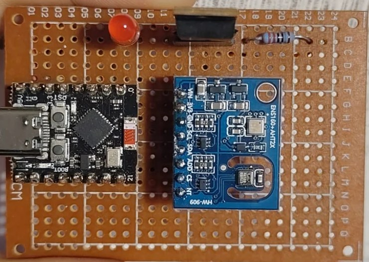
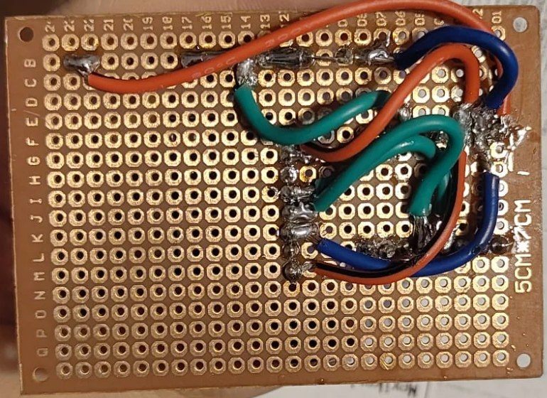

# ESP32 Air Quality Ventilation Controller

An embedded ventilation system that monitors air quality and controls a fan using an ESP32 and a MOSFET-based driver circuit.

## Overview

An ESP32-C3 project that reads temperature, humidity and air-quality data over I²C
and will switch a ventilation fan through a MOSFET. The sensor drivers are written
in C on ESP-IDF, directly from the datasheets.

**Status**

- AHT20 (temperature/humidity) driver: done, tested on hardware
- ENS160 (air quality) driver: in progress
- Fan control: planned

**Prototype** (hand-soldered on perfboard: ESP32-C3, ENS160/AHT20 sensor module, MOSFET, LED)

| Front | Back |
|---|---|
|  |  |

## Project Goals

- Read environmental data from an air-quality sensor
- Develop a sensor driver based on the device datasheet
- Control a ventilation fan through a MOSFET
- Adjust fan operation according to air-quality measurements
- Handle sensor and communication failures safely
- Verify the system through measurements and long-duration testing

## System Architecture

```text
Air-Quality Sensor
        │ I²C / UART
        ▼
      ESP32
        │ GPIO / PWM
        ▼
 MOSFET Driver ── Fan
```

## Repository Structure

